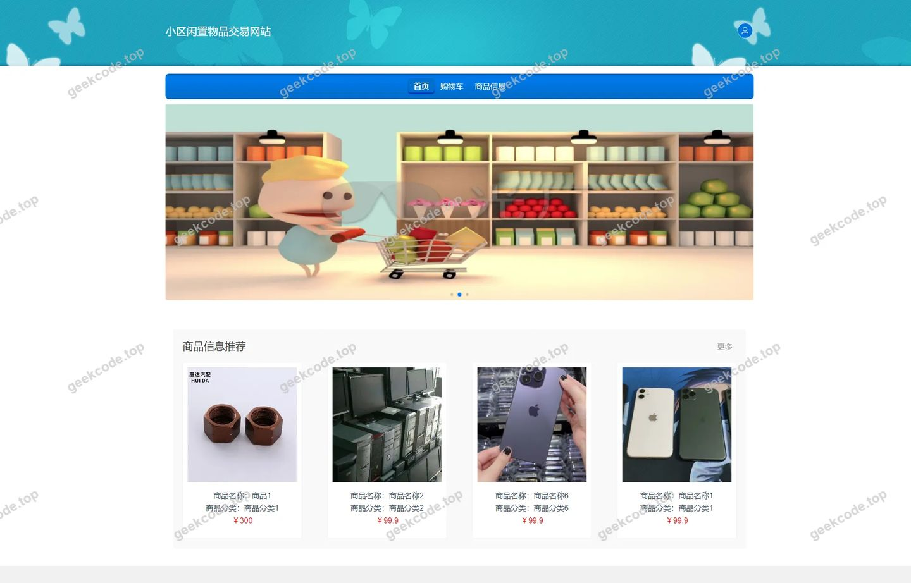
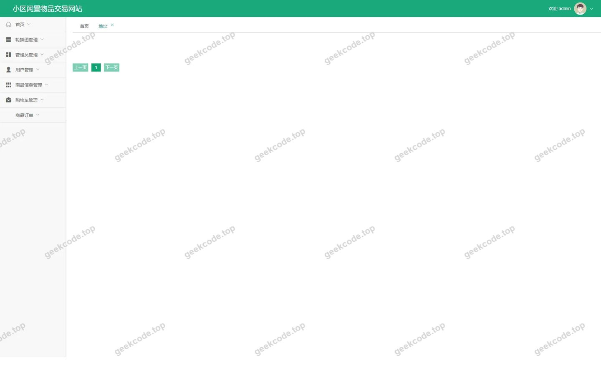
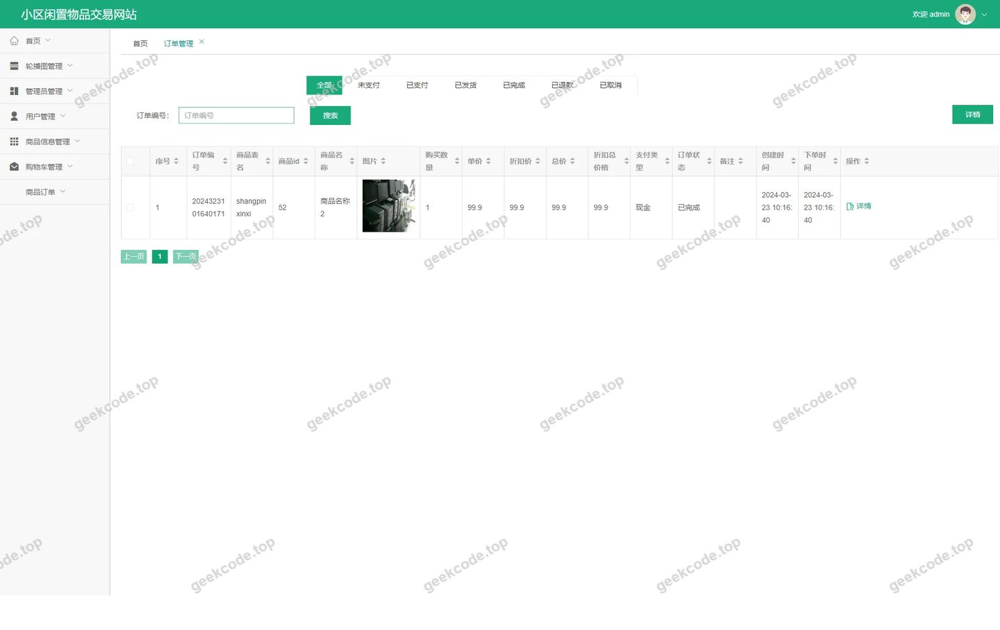
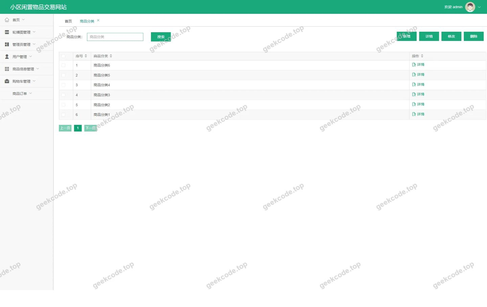
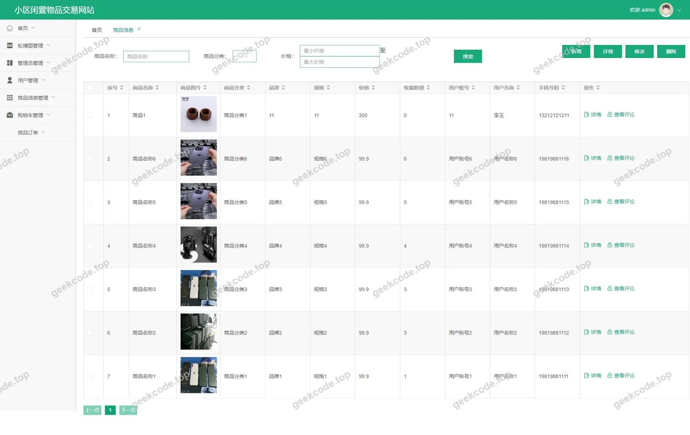
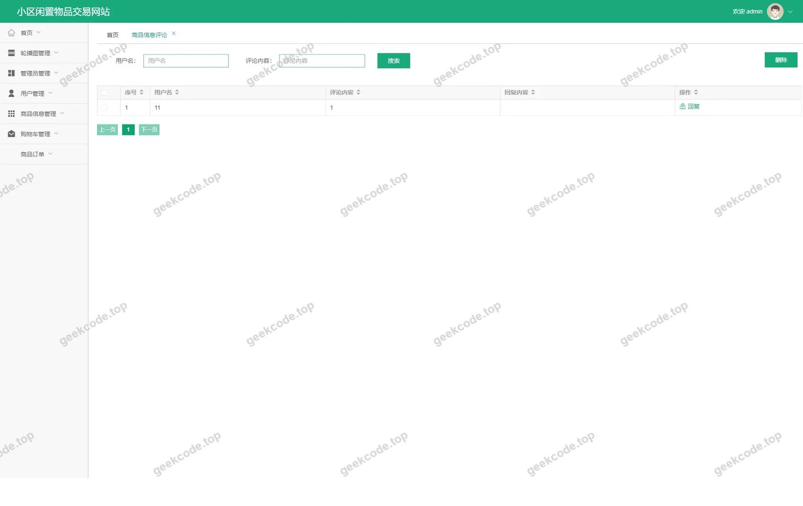
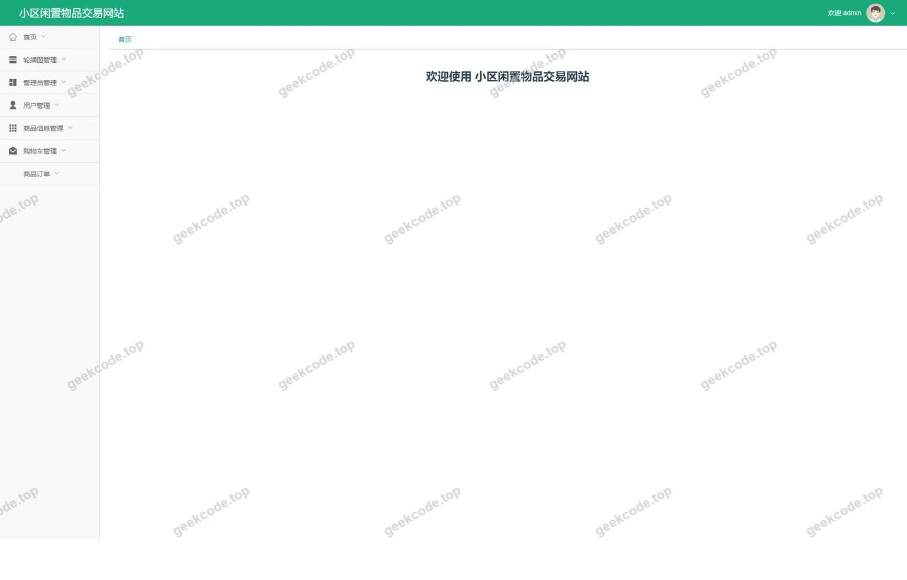
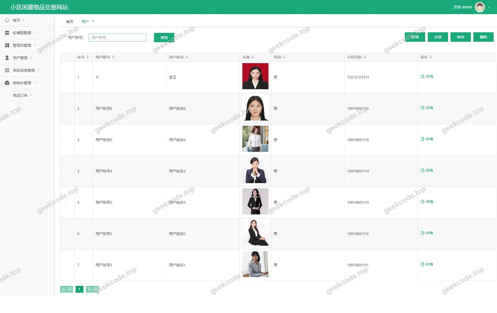

# java小区闲置物品交易网站

> 🎓 **计算机毕业设计 · java小区闲置物品交易网站**
>
> 本仓库只放**项目介绍 + 运行截图**（截图是站点带水印的原图，存在仓库 `images/` 里）。
>
> 👉 **完整可运行源码 / 数据库脚本 / 部署文档：[点我获取](https://geekcode.top/archives/java%E5%B0%8F%E5%8C%BA%E9%97%B2%E7%BD%AE%E7%89%A9%E5%93%81%E4%BA%A4%E6%98%93%E7%BD%91%E7%AB%99?utm_source=github)**
>
> 💬 咨询微信：**ir9372**　|　🌐 更多项目：[极客代码 geekcode.top](https://geekcode.top/?utm_source=github)
>
> 📌 项目详情页：<https://geekcode.top/archives/java%E5%B0%8F%E5%8C%BA%E9%97%B2%E7%BD%AE%E7%89%A9%E5%93%81%E4%BA%A4%E6%98%93%E7%BD%91%E7%AB%99?utm_source=github>

<table><td width="230" align="center"> <b>扫码加微信 ir9372</b></td><td valign="middle">📦 源码 = 项目介绍 + 全部运行截图 + 数据库 + 部署文档 👉 点上方任意截图，直接跳到 <b>极客代码 geekcode.top</b> 详情页</td></table>

---

<h1>java小区闲置物品交易网站</h1>
<h2>项目概述</h2>

本项目名为“java小区闲置物品交易网站”，旨在为社区居民提供一个便捷、安全的二手闲置物品交易平台。随着环保意识的提升和共享经济的发展，居民家中大量闲置物品亟需流通渠道。本系统通过数字化手段连接买家与卖家，实现商品发布、分类浏览、在线下单及评价互动等功能。

核心功能涵盖用户注册登录、商品信息管理与检索、购物车结算、订单处理以及后台的全方位数据管理。适用人群主要为小区住户（普通用户）及平台管理员。技术架构采用前后端分离模式，后端基于 Spring Boot 框架结合 MyBatis-Plus 进行高效数据持久化操作，使用 Shiro 保障系统安全；前端采用 Vue 框架构建响应式界面，确保良好的用户体验。该项目有效解决了传统线下交易信息不对称、效率低下的痛点，促进了社区资源的循环利用。

<h2>技术架构</h2>
<h3>前后端架构</h3>

本项目采用典型的 <strong>Vue-Integrated</strong> 前后端分离架构：

<ul>
<li><strong>后端服务层</strong>：基于 <strong>Spring Boot</strong> 构建 RESTful API 接口，利用其自动配置特性快速搭建应用骨架。数据访问层采用 <strong>MyBatis-Plus</strong>，在 MyBatis 基础上提供了 CRUD 增强、分页插件等实用功能，大幅简化了数据库操作代码。安全控制模块集成 <strong>Apache Shiro</strong>，负责身份认证与权限授权，确保只有合法用户才能访问特定资源。</li>
<li><strong>前端展示层</strong>：基于 <strong>Vue.js</strong> 生态开发，通过路由管理实现单页面应用（SPA）体验。前台面向终端用户，提供商品浏览、个人中心等服务；后台面向管理员，提供数据监控与管理功能。前后端通过 HTTP 协议进行 JSON 格式的数据交互。</li>
</ul>
<h3>核心技术选型理由</h3>
<ol>
<li><strong>Spring Boot</strong>：作为 Java 企业级开发的主流框架，具备“约定优于配置”的特点，能够显著降低开发复杂度，提高迭代效率。</li>
<li><strong>MyBatis-Plus</strong>：相比原生 JDBC 或 MyBatis，它能减少大量样板代码，支持 Lambda 表达式查询，提升了开发速度与代码可读性。</li>
<li><strong>Shiro</strong>：轻量级的安全框架，易于集成，适合中小型项目的权限管理需求，能有效防止未授权访问。</li>
<li><strong>MySQL</strong>：成熟的开源关系型数据库，稳定可靠，适用于存储结构化业务数据如用户信息、订单记录等。</li>
</ol>
<h3>数据库设计要点</h3>

根据后台路由 <code>/address</code>, <code>/yonghu</code>, <code>/shangpinfenlei</code>, <code>/discussshangpinxinxi</code>, <code>/shangpinxinxi</code>, <code>/orders</code>, <code>/storeup</code>, <code>/config</code>, <code>/users</code>, <code>/cart</code> 推断，数据库主要包含以下核心实体表：

<ul>
<li><strong>用户表 (yonghu/users)</strong>：存储注册用户基本信息及管理员账号。</li>
<li><strong>商品表 (shangpinxinxi)</strong>：记录闲置物品的名称、描述、价格、图片及状态。</li>
<li><strong>分类表 (shangpinfenlei)</strong>：用于商品的类别划分，便于筛选检索。</li>
<li><strong>订单表 (orders)</strong>：记录交易流程中的关键节点，包括下单时间、金额、状态等。</li>
<li><strong>评论表 (discussshangpinxinxi)</strong>：存储用户对商品的评价内容。</li>
<li><strong>收藏表 (storeup)</strong>：记录用户感兴趣的商品。</li>
<li><strong>地址表 (address)</strong>：管理用户的收货地址信息。</li>
<li><strong>购物车表 (cart)</strong>：临时存储待结算的商品项。</li>
</ul>
<h2>功能模块</h2>
<h3>前台用户端</h3>

前台主要服务于普通居民用户，提供完整的交易闭环体验：

<ol>
<li><strong>首页展示 (<code>/index/yonghuList</code>, <code>/index/shangpinxinxiList</code>)</strong>：展示最新发布的闲置物品列表，支持按分类浏览，吸引用户进入详情。</li>
<li><strong>用户注册与登录 (<code>/yonghuRegister</code>, <code>/index/yonghuDetail</code>)</strong>：新用户可通过注册页面创建账号，老用户登录后进入个人中心。</li>
<li><strong>商品浏览与详情 (<code>/index/shangpinxinxiDetail</code>)</strong>：查看具体商品的详细信息、价格及卖家联系方式，支持发表评论。</li>
<li><strong>商品发布 (<code>/index/shangpinxinxiAdd</code>)</strong>：用户可将自家闲置物品上传至平台，填写标题、分类、价格等信息。</li>
<li><strong>购物车管理 (<code>/index/cartList</code>)</strong>：将心仪商品加入购物车，支持批量选择进行结算。</li>
<li><strong>收藏功能 (<code>/index/storeupList</code>)</strong>：用户可收藏喜欢的商品，方便后续查找。</li>
<li><strong>订单中心 (<code>/index/ordersList</code>, <code>/index/order_confirm</code>)</strong>：查看历史订单状态，确认收货或申请售后。</li>
<li><strong>地址管理 (<code>/index/addressList</code>)</strong>：添加、修改或删除收货地址，确保物流信息准确。</li>
<li><strong>个人中心 (<code>/index/yonghuCenter</code>)</strong>：查看个人信息、我的发布、我的收藏等聚合入口。</li>
</ol>
<h3>后台管理端</h3>

后台主要服务于系统管理员，负责平台的运营与维护：

<ol>
<li><strong>后台登录 (<code>admin/login</code>)</strong>：管理员身份验证入口。</li>
<li><strong>首页概览 (<code>admin/index</code>)</strong>：展示平台关键数据统计，如用户数、订单量等（基于截图推测）。</li>
<li><strong>用户管理 (<code>/admin/yonghu</code>, <code>/admin/users</code>)</strong>：查看注册用户列表，可对违规用户进行封禁或删除操作。</li>
<li><strong>商品信息管理 (<code>/admin/shangpinxinxi</code>)</strong>：审核用户发布的商品，编辑商品详情，下架违规物品。</li>
<li><strong>商品分类管理 (<code>/admin/shangpinfenlei</code>)</strong>：维护商品类别体系，新增、修改或删除分类标签。</li>
<li><strong>订单管理 (<code>/admin/orders</code>)</strong>：查看所有交易订单，跟踪发货状态，处理退款请求。</li>
<li><strong>评论管理 (<code>/admin/discussshangpinxinxi</code>)</strong>：监控用户评论内容，删除不良言论，维护社区氛围。</li>
<li><strong>地址管理 (<code>/admin/address</code>)</strong>：查看用户提交的地址信息（主要用于数据备份或审计）。</li>
<li><strong>收藏管理 (<code>/admin/storeup</code>)</strong>：查看热门收藏商品，辅助运营决策。</li>
<li><strong>系统配置 (<code>/admin/config</code>)</strong>：设置平台基础参数，如轮播图、公告信息等。</li>
<li><strong>购物车数据查看 (<code>/admin/cart</code>)</strong>：监控用户购物车行为数据。</li>
</ol>
<h2>用户角色与权限</h2>

本项目主要涉及两类角色：<strong>普通用户</strong>和<strong>管理员</strong>。

<h3>1. 普通用户 (User)</h3>
<ul>
<li><strong>定义</strong>：注册并登录平台的社区居民。</li>
<li><strong>权限范围</strong>：</li>
<li><strong>浏览权限</strong>：可查看首页、商品列表、商品详情、分类列表。</li>
<li><strong>交易权限</strong>：可发布闲置商品、加入购物车、提交订单、管理收货地址。</li>
<li><strong>互动权限</strong>：可对商品发表评论、收藏商品。</li>
<li><strong>个人管理</strong>：可查看和编辑个人资料、查看自己的订单记录、收藏列表及发布记录。</li>
<li><strong>限制</strong>：无法访问后台管理菜单，无法删除他人评论或修改系统配置。</li>
</ul>
<h3>2. 管理员 (Admin)</h3>
<ul>
<li><strong>定义</strong>：负责平台日常运营和技术维护的工作人员。</li>
<li><strong>权限范围</strong>：</li>
<li><strong>全局管理</strong>：拥有对所有数据的增删改查权限。</li>
<li><strong>用户管理</strong>：可查看所有用户信息，重置密码或禁用账号。</li>
<li><strong>内容审核</strong>：可管理商品分类、审核上架商品、删除违规评论。</li>
<li><strong>订单处理</strong>：可查看全平台订单，干预异常交易状态。</li>
<li><strong>系统设置</strong>：可修改系统配置文件，管理平台公告及基础数据。</li>
<li><strong>限制</strong>：通常不直接参与前台的购物流程（如购买自己的商品），主要聚焦于监管与维护。</li>
</ul>
<h2>项目特色与创新点</h2>
<ol>
<li><strong>垂直场景深耕</strong>：不同于淘宝、闲鱼等大型综合平台，本项目专注于“小区”这一特定地理和社会单元。这种定位使得交易双方信任成本更低，物流交付更便捷（如自提），更符合邻里互助的社交属性。</li>
<li><strong>轻量化交易闭环</strong>：系统设计了从“发布-浏览-加购-下单-评价”的完整极简链路，去除了复杂的支付网关对接和物流追踪系统，专注于信息撮合，降低了开发和部署门槛，适合小规模社区快速落地。</li>
<li><strong>双向互动机制</strong>：不仅支持买家对商品的评价（评论模块），还强化了卖家的自主发布权（商品添加模块），形成了活跃的内容生产生态。同时，收藏和购物车功能增强了用户的粘性，促进复购。</li>
<li><strong>技术栈稳健且高效</strong>：采用 Spring Boot + MyBatis-Plus + Shiro 的经典组合，既保证了系统的稳定性和安全性，又通过 MyBatis-Plus 提升了开发效率。Vue 的前端架构确保了页面的流畅性和响应速度，适配多种终端设备。</li>
</ol>
<h2>部署环境</h2>

为确保“java小区闲置物品交易网站”正常运行，需准备以下软件环境：

<table>
<thead>
<tr>
<th align="left">组件</th>
<th align="left">版本要求/说明</th>
<th align="left">备注</th>
</tr>
</thead>
<tbody><tr>
<td align="left"><strong>操作系统</strong></td>
<td align="left">Windows 10/11, Linux (CentOS/Ubuntu), macOS</td>
<td align="left">推荐 Linux 用于服务器部署</td>
</tr>
<tr>
<td align="left"><strong>JDK</strong></td>
<td align="left">JDK 1.8 或更高版本</td>
<td align="left">Spring Boot 依赖 Java 运行环境</td>
</tr>
<tr>
<td align="left"><strong>Maven</strong></td>
<td align="left">3.6+</td>
<td align="left">用于后端项目依赖管理和打包</td>
</tr>
<tr>
<td align="left"><strong>Node.js</strong></td>
<td align="left">14.x 或 16.x LTS</td>
<td align="left">用于前端 Vue 项目的依赖安装与构建</td>
</tr>
<tr>
<td align="left"><strong>npm/yarn</strong></td>
<td align="left">最新版</td>
<td align="left">Node.js 包管理器</td>
</tr>
<tr>
<td align="left"><strong>MySQL</strong></td>
<td align="left">5.7 或 8.0</td>
<td align="left">数据库服务，需初始化相关表结构</td>
</tr>
<tr>
<td align="left"><strong>IDE</strong></td>
<td align="left">IntelliJ IDEA / Eclipse</td>
<td align="left">后端开发工具</td>
</tr>
<tr>
<td align="left"><strong>编辑器</strong></td>
<td align="left">VS Code</td>
<td align="left">前端开发工具</td>
</tr>
<tr>
<td align="left"><strong>浏览器</strong></td>
<td align="left">Chrome / Edge / Firefox</td>
<td align="left">现代浏览器，支持 ES6+ 标准</td>
</tr>
</tbody></table>

<strong>部署步骤简述</strong>：

<ol>
<li>安装并配置 MySQL，创建数据库并导入 SQL 脚本。</li>
<li>修改后端 <code>application.yml</code> 配置文件中的数据库连接信息。</li>
<li>使用 Maven 命令编译打包后端 jar 文件，并通过 <code>java -jar</code> 启动服务。</li>
<li>进入前端目录，执行 <code>npm install</code> 安装依赖。</li>
<li>配置前端 API 代理指向后端服务地址。</li>
<li>执行 <code>npm run serve</code> 启动本地开发服务器，或使用 <code>npm run build</code> 生成静态文件部署至 Nginx。</li>
</ol>
<h2>五、技术特性</h2>
<ul>
<li>前后端集成部署，前端资源打包至后端 static 目录</li>
<li>使用 MyBatis-Plus 简化数据访问层开发</li>
<li>集成 Shiro 权限框架实现角色权限控制</li>
</ul>
<h2>六、功能模块截图</h2>
<h3>前台用户端</h3>
<h4>前台-首页</h4>

<h4>前台-登录</h4>

<h4>前台-用户注册</h4>

<h3>后台管理端</h3>
<h4>后台-地址</h4>

<h4>后台-登录页</h4>

<h4>后台-订单管理</h4>

<h4>后台-商品分类</h4>

<h4>后台-商品信息</h4>

<h4>后台-商品信息评论</h4>

<h4>页面-首页</h4>

<h4>后台-用户</h4>

---

## 获取完整源码

| 项目 | 说明 |
| --- | --- |
| 项目名 | java小区闲置物品交易网站 |
| 运行截图 | 本文 11 张（站点带水印原图，仓库 `images/` 目录） |
| 完整源码 | [https://geekcode.top/archives/java%E5%B0%8F%E5%8C%BA%E9%97%B2%E7%BD%AE%E7%89%A9%E5%93%81%E4%BA%A4%E6%98%93%E7%BD%91%E7%AB%99?utm_source=github](https://geekcode.top/archives/java%E5%B0%8F%E5%8C%BA%E9%97%B2%E7%BD%AE%E7%89%A9%E5%93%81%E4%BA%A4%E6%98%93%E7%BD%91%E7%AB%99?utm_source=github) |
| 咨询微信 | **ir9372**（备注：jingpin-yuanma） |
| 更多项目 | [极客代码 geekcode.top](https://geekcode.top/?utm_source=github) |

> 需要源码、部署、改配置、跑不起来等问题，加微信 ir9372 沟通，说明项目名即可。
